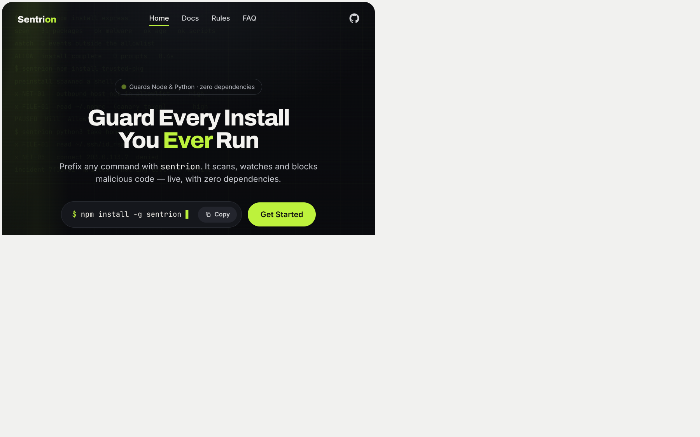
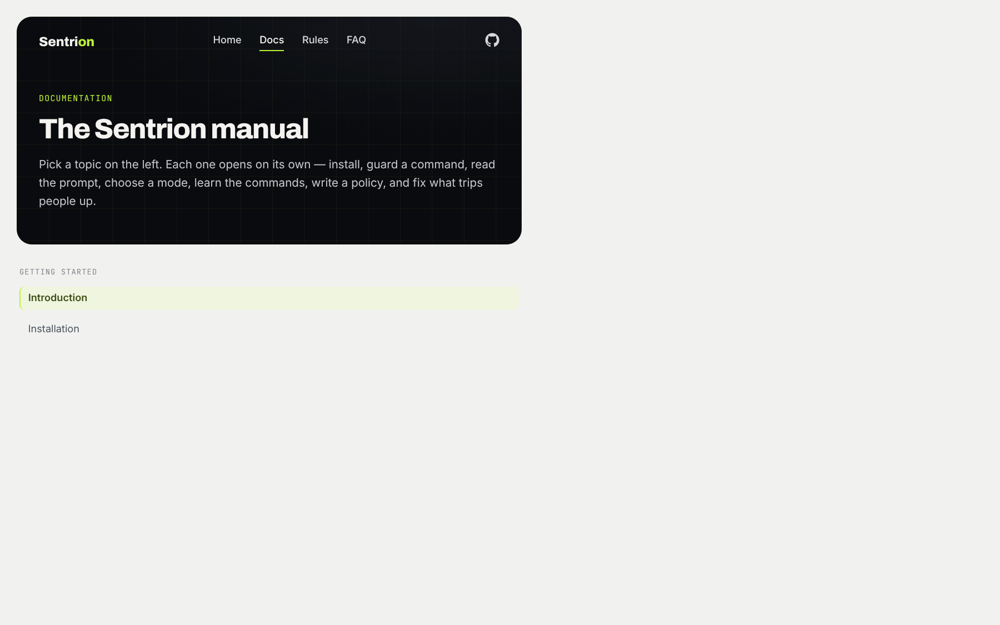

# Sentrion

<div align="center">

[](https://sentrion-seven.vercel.app/)
[](https://sentrion-seven.vercel.app/docs/)
[](LICENSE)
[](https://nodejs.org/)

</div>

**Guard every install you ever run.** Sentrion wraps a command, inspects the package, and watches the process tree to stop malicious install scripts, credential theft, backdoors, persistence changes, and outbound exfiltration — live, with zero runtime dependencies.

```bash
npm install -g sentrion
sentrion npm install express
```

<div align="center">
  
</div>

## Why Sentrion

Package installation is remote code execution. A package can run code before you review it, and a trusted dependency can become malicious in a future update.

Sentrion treats installation as a checkpoint:

- **Stops before it starts** - scans malware, publish age, typosquats, and newly added install scripts.
- **Watches while it runs** - observes Node and Python files, processes, child processes, and network activity.
- **Shows the evidence** - names the exact rule that fired instead of presenting a vague risk score.
- **Fails safely** - ends the command and process tree in Kill mode, or blocks unattended commands in CI and servers.
- **Keeps the machine private** - runs locally and sends no source code or secrets to a remote service.

<div align="center">
  
</div>

## What Sentrion does

Every command you run may execute code you have never read. Sentrion adds a security checkpoint around that command and handles it in four stages:

1. **Pre-flight scan** - checks known malware, package publish age, typosquat names, and newly introduced install scripts.
2. **Runtime watch** - observes the process tree and Node and Python file, process, and network activity.
3. **Decision** - freezes a risky action and presents a clear `Kill`, `Allow once`, or `Trust` choice.
4. **Incident report** - records the attack chain and can export its evidence as JSON or SARIF.

Clean commands continue normally. Risky commands stop without a vague score; Sentrion names the exact rule that triggered.

## Install

Sentrion is a Node.js CLI with zero runtime dependencies. It requires Node.js 18 or newer and can run on Linux, macOS, and Windows.

```bash
npm install -g sentrion
```

Other supported package managers:

```bash
pnpm add -g sentrion
yarn global add sentrion
bun add -g sentrion
```

If `sentrion` is not on your `PATH`, use `npx sentrion` or add npm's global binary directory:

```bash
export PATH="$(npm config get prefix)/bin:$PATH"
```

Add the export line to `~/.bashrc` or `~/.zshrc` to keep it for future terminal sessions.

## Quick start

Prefix any command with `sentrion`:

```bash
sentrion npm install express
sentrion pnpm add zod
sentrion python3 app.py
sentrion node build.js
```

Check the security capabilities available on the current machine:

```bash
sentrion doctor
```

Scan a package without installing it:

```bash
sentrion scan left-pad
```

View the latest incident report:

```bash
sentrion report --last
```

Export a SARIF report:

```bash
sentrion report --sarif
```

For the complete command reference, run:

```bash
sentrion --help
```

## Guards and package managers

Sentrion can guard installs from npm, pnpm, Yarn, Bun, pip, uv, and poetry. It also watches commands and child processes written for Node and Python.

At runtime, it can detect and stop actions such as:

- shells and download-then-execute chains started by install scripts
- reads from SSH keys, AWS credentials, npm configuration, keychains, and wallets
- writes into packages, Git hooks, or CI configuration
- persistence changes and reverse shells
- uploads to paste services, raw IP addresses, or chat webhooks
- package publishing or repository creation initiated by a dependency

The complete default pre-flight and runtime rule set is documented on the [Rules page](https://sentrion-seven.vercel.app/rules/).

## Modes

Choose a mode for one run with `--mode`, or set a default in a policy file:

| Mode | Behaviour |
| --- | --- |
| `prompt` | Pause and ask with `Kill`, `Allow once`, or `Trust`. This is the default for interactive machines. |
| `enforce` | Block by policy without waiting for a prompt. Recommended for servers and CI. |
| `audit` | Log activity without blocking it. Useful for observing existing installs. |
| `learn` | Record observed behaviour and propose allow rules. |

```bash
sentrion --mode enforce npm ci
sentrion --mode audit npm install
sentrion --mode learn npm install
```

For CI and servers with no interactive user:

```bash
npx sentrion --mode enforce npm ci
```

Pending prompts fail closed in CI.

## Kill, allow, or trust

When a rule fires, Sentrion presents:

```text
[K] Kill
[A] Allow once
[T] Trust
```

- **Kill** ends the command and its process tree immediately.
- **Allow once** permits this action only for the current run.
- **Trust** remembers the package, version range, and behaviour. A later package version or changed behaviour prompts again.

## Always-on shell protection

Load the shell hook to guard package-manager commands automatically:

```bash
eval "$(sentrion shell-init)"
```

Add that line to `~/.zshrc` or `~/.bashrc` for a permanent setup. The shell hook also covers nested installs launched by build scripts.

## Policy configuration

Sentrion merges policies from two locations:

1. `~/.sentrion/policy.json` - personal machine policy
2. `./.sentrion.json` - project policy

A project policy can make the guard stricter, but cannot loosen a personal policy.

```json
{
  "mode": "enforce",
  "allow": ["esbuild@^0.20"],
  "deny": ["NET-*"]
}
```

## Verify and troubleshoot

| Problem | Resolution |
| --- | --- |
| `sentrion: command not found` | Use `npx sentrion`, or add npm's global binary directory to `PATH`. |
| A trusted package asks again | Review the new evidence. Trust is version- and behaviour-specific. |
| The doctor reports an optional egress helper | The helper provides kernel-level network hardening. Base mode still detects and kills outbound activity. |
| npm triggers a file rule | File rules are intended for install scripts, not npm's normal reads. Run `sentrion doctor` if unexpected warnings persist. |
| Nothing prompts in CI | Use `--mode enforce`; unattended prompts fail closed. |

## Privacy

Sentrion runs locally. It does not send source code or secrets to a remote service and does not require root or administrator access for normal detection and blocking. Optional hardening features may add a system helper for capabilities such as deeper kernel tracing or an egress lock.

## This website

This repository contains the public Sentrion Next.js website and documentation. It includes:

- Home page and product overview
- Interactive documentation for installation and usage
- Default rule reference
- FAQ and troubleshooting
- Static export for Vercel or other static hosts

### Technology

- Next.js 16 App Router
- React 19
- Tailwind CSS 3
- Static export
- Zero runtime third-party scripts
- One small client component for copying install commands

The rest of the site is server-rendered or prerendered static HTML.

## Develop

Requirements: Node.js 18 or newer.

```bash
npm install
npm run dev
```

Open `http://localhost:3000`.

## Build

Create a production static export:

```bash
npm run build
```

The deployable output is written to `out/`. The site can be hosted on Vercel, Netlify, Cloudflare Pages, GitHub Pages, or another static host.

Vercel configuration is stored in `vercel.json`. Static host headers are also available in `public/_headers`.

## Project structure

```text
app/
  page.jsx         # Home page
  docs/page.jsx    # Interactive documentation
  rules/page.jsx   # Default rule reference
  faq/page.jsx     # FAQ
  layout.jsx       # Site metadata and CSP
  globals.css      # Global styles and animations
components/
  SiteNav.jsx      # Main navigation
  Masthead.jsx     # Page header
  Footer.jsx       # Footer
  CopyCmd.jsx      # Copy-install-command control
public/
  _headers         # Static hosting security headers
  favicon.svg
out/               # Generated static export
```

## Contributing

Contributions are welcome for bug fixes, false-alarm reports, missing rules, documentation improvements, and website changes.

```bash
git clone https://github.com/imeerai/sentrion.git
cd sentrion
npm install
npm test
```

The core project is MIT licensed and has a zero-dependency CLI. Keep security changes focused, reproducible, and covered by tests.

## License

MIT License. Copyright 2026 Imeer.ai / imeerai.