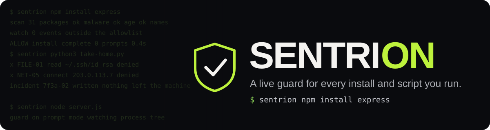
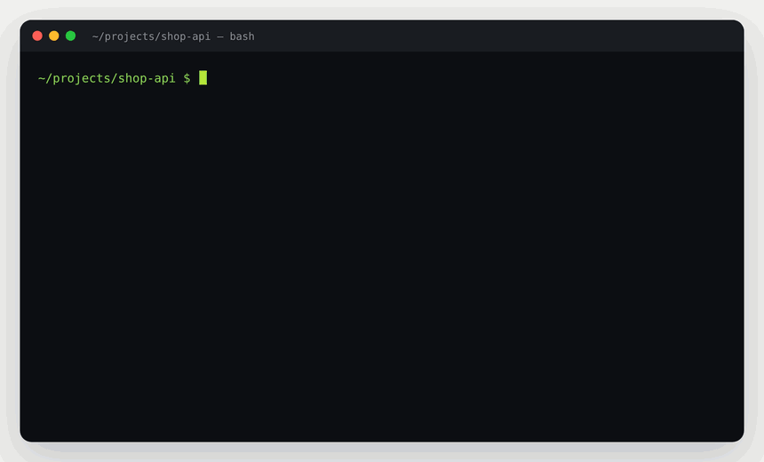

<div align="center">



<br/>

**A command-line security guard for developers.** Put `sentrion` in front of any command and it scans, watches and blocks malicious install scripts, credential theft, backdoors and privilege escalation, with a Kill / Allow prompt and a readable incident report.

[](https://www.npmjs.com/package/sentrion)
[](LICENSE)
[](https://nodejs.org)
[](package.json)
[](#platform-notes)
[](https://www.npmjs.com/package/sentrion)

<br/>

**Zero third-party dependencies, one Node.js file.** The tool you install to vet other packages brings no supply chain of its own.

</div>

> [!IMPORTANT]
> Sentrion is an early public release. Base mode needs no root and runs anywhere Node does. It is a safety net, not full OS or container isolation: see [Scope and limitations](#scope-and-limitations) for what it does and does not cover. Found a gap? Please [open an issue](https://github.com/imeerai/sentrion/issues).

## The problem

Every `npm install` runs code you have never read. A single malicious install script can read your SSH keys, exfiltrate an npm token, or open a backdoor before the install even finishes, and turning install scripts off just moves the trigger to the first time you run the package. Sentrion sits in front of the command, watches what the code actually does, and stops the risky part while letting clean code run normally.

## Quick start

Install it once, globally:

```bash
npm install -g sentrion
```

Then put `sentrion` in front of any command you run:

```bash
sentrion npm install express
sentrion pip install requests
sentrion node server.js
sentrion python3 app.py
```

Check it is working:

```bash
sentrion --version
sentrion doctor
```

<div align="center">

</div>

> **`sentrion: command not found`?** After a global install this means npm's global bin folder is not on your `PATH` (common on Debian and Kali). Add it once with `export PATH="$(npm config get prefix)/bin:$PATH"`, put that line in your `~/.bashrc` or `~/.zshrc`, then open a new terminal.

## How it works

Sentrion wraps your command and watches it on two levels at once:

- **In-process hooks** load inside Node (`--require`) and Python (an audit hook via `sitecustomize`), so it sees file reads, network calls and spawns from within the runtime, before they complete.
- **Process-tree sensors** read `/proc` to follow every child the command starts, and can pause or kill the whole process group.

When something risky happens, it pauses and shows you the evidence: which package, which rule, and the exact chain of events. You press **K** to kill, **A** to allow once, or **P** to trust that package. Every decision is written to an incident report you can read later or export as SARIF for CI.

## Modes

| Mode      | Behavior                                                             |
| --------- | -------------------------------------------------------------------- |
| `prompt`  | Pause on a risky event and ask: kill, allow once, or trust (default) |
| `enforce` | Apply the policy and block without asking (servers, CI)              |
| `audit`   | Record risky events without blocking them                            |
| `learn`   | Record normal behavior and propose trust rules                       |

```bash
sentrion --mode enforce npm install express   # one command
sentrion mode enforce                          # set the default
sentrion --ci npm install                      # non-interactive CI run
```

## Common commands

```bash
sentrion scan express@4.21.2     # inspect a package, nothing runs
sentrion scan .                  # inspect this repo or clone
sentrion report --last           # what happened and why it was stopped
sentrion report <id> --format sarif
sentrion rules                   # the full rule set
sentrion trust esbuild@^0.20     # allow one package's scripts, pinned
sentrion policy show             # the effective, merged policy
sentrion doctor                  # what your OS lets Sentrion see and block
```

Run `sentrion --help` for the full list.

## What it catches

Across npm, pnpm, Yarn, Bun, pip, uv and poetry installs, and any command you run in Node or Python:

- Install and lifecycle scripts that spawn a shell or reach the network
- Reads of credentials and secrets (`~/.ssh`, `~/.aws`, `~/.npmrc` and more), with canary tokens in place of the real ones
- Outbound connections to hosts outside the install allowlist
- Suspicious packages by name (typosquats) and against a bundled malware list

## Scope and limitations

Sentrion is a practical safety net, not a sandbox, and it is honest about its edges:

- It is not OS or container isolation. For untrusted code you do not control, run it in a VM or container as well.
- The in-process hooks do not reach a child that deliberately strips `NODE_OPTIONS`, or Python started in isolated mode (`python -I`). The process-tree sensors still see such a child, but a fast action can finish before the next poll.
- If the guard's own parent is `SIGKILL`ed, a detached child can survive.
- The egress lock and deep (eBPF/auditd) mode need the privileged helper; base detection does not.

Run `sentrion doctor` to see exactly which controls your system supports.

## Benchmark

On a small synthetic benchmark (Node and Python, Linux): 9 of 9 attack samples in the suite were caught, with 0 false alarms across 7 clean installs, at roughly 50 ms of added startup per command. These are indicative numbers from one machine, not a formal evaluation.

## Platform notes

- Linux and macOS use process-tree monitoring.
- Windows uses its available process and network controls.
- Some firewall, administrative and deep-monitoring features need elevated permissions.

## Contributing

Issues and pull requests are welcome at [github.com/imeerai/sentrion](https://github.com/imeerai/sentrion). Sentrion has zero third-party dependencies by design; please keep it that way.

## License

MIT &copy; 2026 [imeerai](https://imeer.ai). See [LICENSE](LICENSE).
